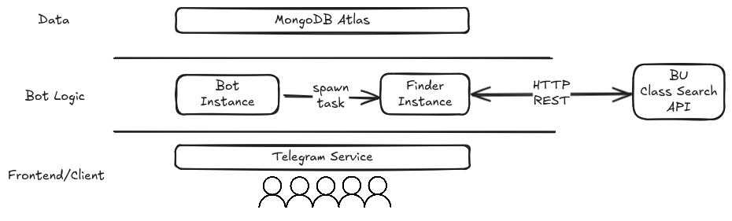

# Terrier Alert

A Python service that collects class information at Boston University and sends a notification via [Telegram](https://telegram.org/) bot when a class is open.

Deployed on [Render](https://render.com/).

> [!WARNING]
> **Alerts paused.** Since around October 12, 2026, BU's public class search (`public.mybustudent.bu.edu`) has answered every request with HTTP 503 "No backend server available". The bot detects HTTP errors and timeouts from the search. It then pauses checks and posts to the feedback channel, once when the search goes down and once when it recovers. The flag is held in memory, so each restart can post the outage message again. Subscriptions stay in place while the search returns errors.

## Demo


### Register Feature (Deprecated)


## System Design Overview



## Technical Details

Seat data comes from BU's public class search through `BUClassSearch` in [src/search.py](src/search.py).
`Finder` in [src/finder.py](src/finder.py) depends only on the `CourseSearch` protocol, so a different seat data source can replace BU's public search without changes to the finder.

Database is a MongoDB Atlas Cluster.  
There are two collections: _courses_ and _users_.

Each document in the _courses_ collection has the following schema:

- \_id: `ObjectId`
- name: `String`
- users: `String[]`

Each document in the _users_ collection has the following schema:

- \_id: `ObjectId`
- user: `String`
- last_subscribed: `Date`
- is_subscribed: `Boolean`
- last_subscription: `String`

## Development

```sh
python -m venv .venv && . .venv/bin/activate
pip install -r requirements-dev.txt
ruff check . && ruff format --check .
pytest -m "not live"   # unit tests, no network
pytest -m live         # queries BU's live class search; skips while BU is down
```

Create a `.env` file with `TELEGRAM_TOKEN`, `TEST_TELEGRAM_TOKEN`, `FEEDBACK_CHANNEL_ID`, `MONGO_URL` and `REPO_URL`. Then run the dev bot:

```sh
./src/main.sh --dev
```

Run the admin scripts from the repository root as modules, for example `python -m admin.commands`.
